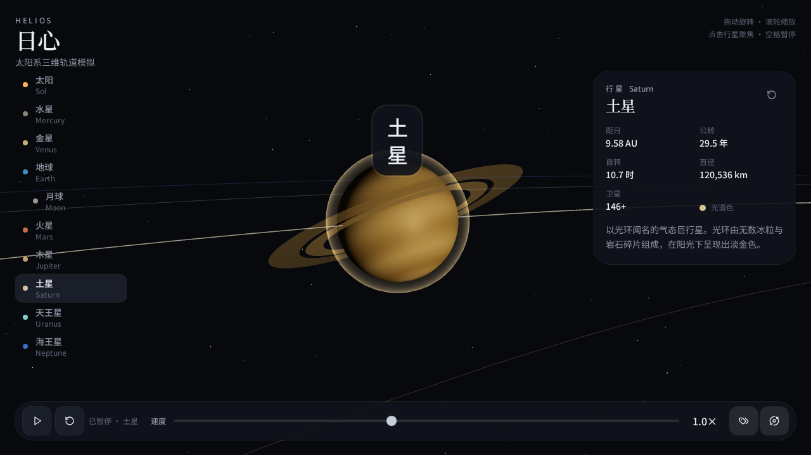

# Helios | 3D Solar System Simulator

**English** | [简体中文](README.zh-CN.md)

Explore the solar system in an interactive 3D scene. Helios lets you watch planets orbit the Sun, change the pace of the simulation, and smoothly focus the camera on a celestial body to take a closer look.

This project was built with **Grok Build** from a natural-language prompt. The result met the creator's expectations: a dark, space-inspired solar system with animated orbits and direct, interactive controls.



## Features

- **Sun, eight planets, and the Moon:** animated orbital motion and axial rotation, with the Moon orbiting Earth.
- **Adjustable simulation speed:** a logarithmic slider from 0.125x to 16x, plus pause and resume.
- **Smooth camera focus:** click a body or select it from the navigation to transition toward it and follow its motion.
- **Labels and orbit paths:** independently show or hide names and orbital guides.
- **Body information:** a brief description and, on desktop, facts such as orbital period, rotation period, diameter, and satellite count.
- **Space-inspired visuals:** a star field, procedural planet textures, atmospheric glow, planetary rings, and an asteroid belt.
- **Responsive layout:** desktop navigation and information panels, with compact information and a horizontal body selector on mobile.
- **Saved preferences:** speed, label visibility, and orbit visibility are stored locally in the browser.

## Controls

| Action | Control |
| --- | --- |
| Rotate the view | Drag the scene |
| Zoom | Mouse wheel |
| Focus on a body | Click it in the scene or select it in the body list |
| Pause / resume orbital motion and rotation | Play/pause button or `Space` |
| Adjust simulation speed | Speed slider |
| Toggle name labels | Label button or `L` |
| Toggle orbit paths | Orbit button or `O` |
| Return focus to the Sun | Reset-view button or `Esc` |

The application interface is currently in Chinese. The language links at the top switch between the two README documents.

## Built with Grok Build

The original prompt was written in Chinese. Its English translation is:

> Create a 3D solar system simulator that shows planets moving along their orbits, with controls to adjust the simulation speed, display name labels, and smoothly focus the camera when a planet is clicked. Add pause controls, orbit trails, and a brief information panel for each planet. Use a dark, space-inspired visual style and keep the animation loop smooth and fluid.

The original Chinese prompt is preserved in the [Chinese README](README.zh-CN.md#使用-grok-build-构建).

## Tech stack

| Layer | Technology |
| --- | --- |
| Application | React 19, TypeScript, TanStack Start / Router |
| 3D rendering | Three.js, React Three Fiber, Drei |
| State and preferences | Zustand with browser local storage |
| Styling and icons | Tailwind CSS 4, Lucide React |
| Development and build | Vite 8, Nitro with the Vercel preset |

## Local development

Use Node.js 22.12 or newer in the Node.js 22 series, npm, and a modern browser with WebGL support. The generated scripts target a Linux environment; Windows users should use WSL.

```bash
git clone https://github.com/yanyintingyou/pixel-gold-ruby-drum.git
cd pixel-gold-ruby-drum
npm ci
npm run dev
```

Open [http://localhost:8080](http://localhost:8080).

Additional commands defined by the project:

```bash
npm run typecheck
npm run build
npm run preview
```

The preview server is configured for [http://localhost:8081](http://localhost:8081). Use the npm scripts so the Grok Build environment wrapper is applied. The checked-in configuration disables authentication, and the simulator does not require a database or an AI API key. The build includes a migration step that skips when `DATABASE_URL` is absent.

## Project layout

```text
src/components/solar/   3D scene, camera, canvas, and interface
src/lib/solar/          Body data, animation logic, textures, and state
src/routes/             Application routes and document shell
screenshots/            Existing application screenshots
```

## Simulation scope

Helios is a visual exploration demo, not a precision astronomical simulator. Orbits are simplified to circles in a shared plane; body sizes and orbital distances are scaled for visibility. Orbital motion and axial rotation use separate accelerated time scales, and positions are not based on a live ephemeris or an N-body gravity solver. The information panels contain static reference text rather than live astronomical data.
