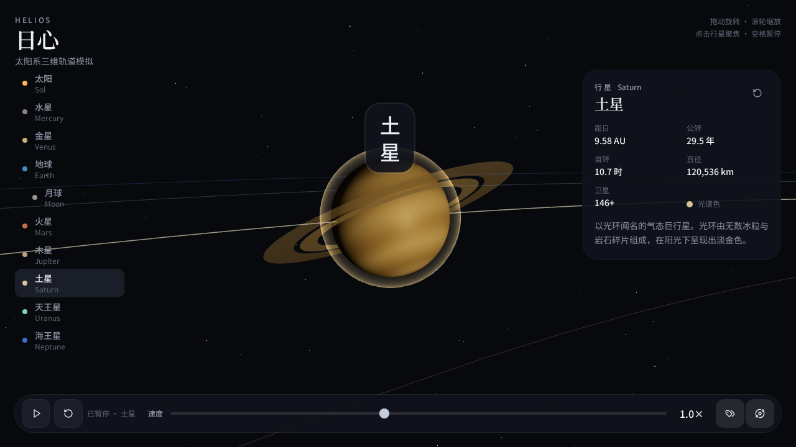

# 日心 Helios | 3D 太阳系模拟器

[English](README.md) | **简体中文**

在交互式三维场景中探索太阳系。你可以观察行星围绕太阳运行，调整模拟速度，也可以点击天体，让镜头平滑靠近并跟随它的运动。

本项目使用 **Grok Build**，通过自然语言提示词构建。最终结果符合预期：以深色太空场景呈现太阳系，将轨道动画、天体观察和交互控制结合在一起。



## 主要功能

- **太阳、八大行星与月球**：呈现天体公转与自转，月球围绕地球运行。
- **模拟速度调节**：通过对数滑杆在 0.125 倍至 16 倍之间调速，支持暂停与继续。
- **平滑聚焦与跟随**：点击场景中的天体，或通过导航选择天体，镜头会平滑靠近并跟随其运动。
- **名称标签与轨道轨迹**：可分别显示或隐藏天体名称和轨道辅助线。
- **天体信息面板**：展示简要介绍；桌面端还提供公转周期、自转周期、直径、卫星数量等信息。
- **太空视觉效果**：包含星空背景、程序生成的行星纹理、大气辉光、行星环和小行星带。
- **响应式布局**：桌面端提供天体导航和信息面板，移动端采用精简信息与横向天体选择栏。
- **偏好保存**：模拟速度、名称标签和轨道显示设置保存在浏览器本地。

## 操作方式

| 操作 | 控制方式 |
| --- | --- |
| 旋转视角 | 拖动场景 |
| 缩放视角 | 鼠标滚轮 |
| 聚焦天体 | 点击场景中的天体，或在天体列表中选择 |
| 暂停／继续公转与自转 | 播放／暂停按钮，或空格键 |
| 调整模拟速度 | 速度滑杆 |
| 显示／隐藏名称标签 | 标签按钮，或 `L` 键 |
| 显示／隐藏轨道 | 轨道按钮，或 `O` 键 |
| 将焦点返回太阳 | 复位视角按钮，或 `Esc` 键 |

应用界面目前为中文。文档顶部的语言链接用于切换中英文 README。

## 使用 Grok Build 构建

创建项目时使用的原始提示词：

> 创建一个 3D 太阳系模拟器，展示围绕轨道运行的行星，并支持调节模拟速度、显示名称标签，以及点击行星后让镜头平滑聚焦。加入暂停控制、轨道轨迹，以及每颗行星的简要信息面板。整体采用深色、富有太空感的视觉风格，并保持动画循环平滑流畅。

本仓库保留了生成的应用代码，可用于了解这次从自然语言描述到交互式 3D 应用的实现。

## 技术栈

| 层次 | 技术 |
| --- | --- |
| 应用框架 | React 19、TypeScript、TanStack Start / Router |
| 三维渲染 | Three.js、React Three Fiber、Drei |
| 状态与偏好 | Zustand、浏览器本地存储 |
| 样式与图标 | Tailwind CSS 4、Lucide React |
| 开发与构建 | Vite 8、Nitro（Vercel preset） |

## 本地运行

请使用 Node.js 22 系列中的 22.12 或更高版本、npm，以及支持 WebGL 的现代浏览器。生成的脚本面向 Linux 环境，Windows 用户建议使用 WSL。

```bash
git clone https://github.com/yanyintingyou/pixel-gold-ruby-drum.git
cd pixel-gold-ruby-drum
npm ci
npm run dev
```

启动后访问 [http://localhost:8080](http://localhost:8080)。

项目还提供以下命令：

```bash
npm run typecheck
npm run build
npm run preview
```

预览服务配置为 [http://localhost:8081](http://localhost:8081)。请通过 npm 脚本运行，以加载 Grok Build 的环境包装逻辑。仓库中的配置已关闭身份认证，模拟器不需要数据库或 AI API 密钥。构建命令包含数据库迁移步骤，未设置 `DATABASE_URL` 时会跳过该步骤。

## 项目结构

```text
src/components/solar/   三维场景、镜头、画布与交互界面
src/lib/solar/          天体数据、动画逻辑、纹理与状态
src/routes/             应用路由与页面外壳
screenshots/            仓库已有的应用截图
```

## 模拟范围

日心 Helios 是用于直观探索的视觉演示，并非精密天文模拟器。轨道简化为同一平面内的圆形，天体大小与轨道距离经过视觉缩放。公转与自转采用分别加速的时间尺度，天体位置不基于实时星历，也未使用多体引力求解。信息面板中的内容为静态参考介绍，不会实时更新天文数据。

## 许可

MIT，见 [LICENSE](LICENSE)。
